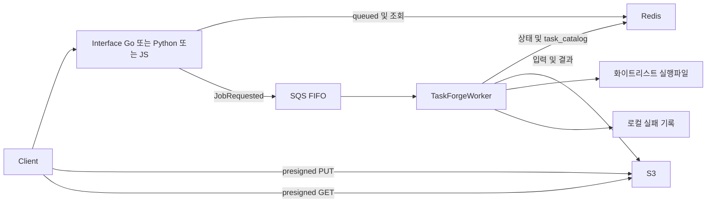

# yirang-taskforge 소프트웨어 아키텍처 기술서 (SAD)

| 항목 | 내용 |
|---|---|
| 문서 ID | YTF-SAD-001 |
| 버전 | 2.0.0 |
| 기준 표준 | ISO/IEC/IEEE 42010:2022 |
| 작성일 | 2026-11-07 (현행화 판) |
| 최종 수정일 | 2026-11-07 |
| 상태 | Active — 사용자 승인 여부를 뜻하지 않음 |
| 대상 커밋 | `6f7fb67` |

## 1. 범위와 관점

C++23 워커와 같은 REST 계약의 Go/Python/TypeScript 대안 구현을 운영하는 포트폴리오입니다. 세 API를 서로 다른 도메인 서비스로 간주하지 않습니다. 계약은 [API](API.md), 요구사항은 [SRS](SRS.md), 실제 검증은 [VERIFICATION](VERIFICATION.md)이 기준입니다. 아래 `file:line`은 대상 커밋 기준이며 심볼명을 함께 표시합니다.

## 2. 시스템 구성

| 구성요소 | 책임 | 구현 근거 |
|---|---|---|
| Go API | HTTP 검증 → 서비스 → Redis/SQS/S3 어댑터 | `Interface/golang/internal/service/job.go:114` `CreateJob` |
| Python API | FastAPI → JobService → 저장소 Protocol | `Interface/python/src/app/services/job_service.py:54` `create_job` |
| JS API | NestJS Controller → JobsService → 주입된 인프라 서비스 | `Interface/js/src/jobs/jobs.service.ts:53` `createJob` |
| 워커 | 설정·연결·소비·상태 전이·재발행 | `Main/TaskForgeWorker.cpp:141` `start` |
| 실행기 | whitelist 조회, 프로세스·stdout 관리 | `Main/TaskExecutor.cpp:40` `execute` |
| DLQ 파일 | 실패 횟수 저장·백로그 집계 | `Main/TaskDLQ.cpp:24` `record_failure` |

## 3. 동작과 수명주기

### 3.1 작업 접수

API는 UUID 발급, presigned PUT URL 생성, Redis `queued` 기록, SQS 발행 순으로 처리합니다. 클라이언트 업로드는 202 응답 후 일어나므로 워커가 업로드보다 먼저 다운로드를 시도할 수 있습니다. 업로드 완료 확인 계약은 없습니다. SQS 발행 실패 시 선기록된 `queued`는 TTL까지 남을 수 있습니다.

### 3.2 소비와 실행

`handle_message`(`Main/TaskForgeWorker.cpp:413`)는 JSON/스키마 검사 후 `process_job`(`:473`)를 동기 호출합니다. 터미널 상태는 스킵하고, whitelist 검사 → running → 입력 다운로드 → 실행 → 결과 업로드 → done 순으로 처리합니다. `set_job_status`(`:740`)는 기존 JSON을 병합하며 `null` 필드는 제거하고 TTL을 적용합니다. `contract_fields`(`:55`)는 메시지에서 `task_name`·`enqueued_at`을 가능한 경우 복원합니다.

`6f7fb67`의 상태 조회 실패는 false로 처리되고 저장 실패도 로그만 남기므로 ACK가 진행되는 결함이 있습니다(T-005). 성공 반환을 ACK로 해석하는 소비자 계약은 `.CppToolkit/AWSService/AWSSQSBase.cpp:109`의 `receive_process_once`에서 확인합니다.

### 3.3 파일·프로세스

`download_inputs`(`Main/TaskForgeWorker.cpp:562`)는 객체별 총 3회 시도합니다. `upload_outputs`(`:598`)는 정규 파일을 업로드하고 URL을 생성합니다. 실행 인자는 `<executable> <inputs_dir> <outputs_dir> [args...]`입니다. `TaskExecutor`는 양수 timeout을 워커 기본값으로 상한 제한합니다. REST의 생략/null은 계약 B에서 필드를 생략하므로 기본값을 사용합니다. 직접 SQS는 필드 부재·정수 0/음수에 기본값을 적용하지만 명시 null은 스키마 위반입니다. REST는 명시 0/음수를 거부합니다. 기준선은 직접 자식만 종료하여 자손이 계속 실행될 수 있습니다(T-004). stdout은 마지막 2048바이트를 보존하고 절단 선두 UTF-8 continuation byte를 제거하지만 임의 바이너리 출력의 UTF-8 유효성까지 보장하지 않습니다.

### 3.4 실패와 재시도

스키마 위반·미등록 태스크는 재시도 없이 종결합니다. 실행/S3 실패는 `handle_processing_failure`(`Main/TaskForgeWorker.cpp:654`)에서 파일 기록 → 지수 백오프·jitter → SQS 재발행 순으로 처리합니다. 메시지 `dlq_try_count`와 로컬 파일 값 중 큰 값을 증가시키므로 파일 소실만으로 예산이 초기화되지 않습니다. 기본 재시도 3회이며 네 번째 실패에서 종결합니다. 재발행 실패도 failed로 종결합니다.

DLQ 파일은 자동 재처리 큐가 아닙니다. 재기동 시 파일만 읽어 재발행하는 소비자는 없습니다. 백오프는 단일 SQS 소비 루프를 막으므로 다른 작업도 대기합니다. 상태 기록·SQS·파일 사이에는 원자적 트랜잭션이 없어 exactly-once 실행을 보장하지 않습니다.

### 3.5 동시성·종료

SQS consumer는 수신 배치를 순서대로 동기 처리합니다. `sqs_max_number_of_messages`는 수신 배치 크기이며 실행 동시성 설정이 아닙니다. 별도 LongTerm 잡이 DLQ 백로그를 감시합니다(`Main/TaskForgeWorker.cpp:391`). 기준선 High/Normal/Low 워커는 제출되는 잡이 없어 T-009 정리 대상입니다.

Logger/AWS SDK는 `Main/main.cpp:24`에서 초기화·종료합니다. Logger와 ThreadPool API는 [module_usage_guide](module_usage_guide.md)를 따릅니다. 신호 핸들러가 Logger·worker.stop을 직접 호출하는 기동 중 충돌은 T-003 대상입니다. `stop(true)`도 실행 중 콜백의 완료와 join은 기다립니다.

## 4. 배포·운영

`docker/docker-compose.yml`은 LocalStack·Redis·Worker·API 3종, 총 6개 서비스를 정의합니다. Worker만 Ubuntu 24.04이고 Go는 Alpine, Python은 slim, Node는 Alpine 이미지입니다. worker 종료 유예는 60초지만 파일 수·원격 호출·SDK 재시도 때문에 모든 작업의 종료 상한을 의미하지 않습니다. `/healthz`와 `/readyz`는 API가 제공합니다. 실 AWS 환경의 IAM·네트워크·서비스 제한은 로컬 E2E와 별도 검증이 필요합니다.

## 5. 아키텍처 결정

| ID | 결정 | 이유·현재 제약 |
|---|---|---|
| ADR-01 | Redis 단일 상태 소스, 응답 큐 없음 | API 폴링으로 조회; 푸시 없음 |
| ADR-02 | 실행파일 whitelist | 임의 명령 경로 금지; 태스크 추가 시 설정 배포 |
| ADR-03 | queued 기록 후 SQS 발행 | 상태 역행 방지; 발행 실패 시 고아 queued 가능 |
| ADR-04 | 소비 핸들러 동기 실행 | ACK 전에 처리; 워커당 직렬 실행 및 종료 대기 |
| ADR-05 | 실패 기록 후 SQS 재발행 | 기준선 핸들러 항상 성공; 상태 저장 장애 예외는 T-005 설계 변경 예정 |
| ADR-06 | 로컬 파일 DLQ | 외부 DLQ 서비스 없음; 파일은 노드 로컬이며 재기동 재발행 없음 |
| ADR-07 | 워커 JSON·API 환경변수 | 구조적 whitelist와 서비스 설정 외부화 |
| ADR-08 | Redis 터미널 상태 가드 | TTL 이후 중복 실행 가능; 조회 오류 fail-open 결함은 T-005 대상 |
| ADR-09 | 재발행 전 동기 백오프 | 재시도 예산 즉시 소진 방지; 소비 루프 전체 대기 |
| ADR-10 | 종결 경로 DLQ 파일 제거 | 성공·결정적 실패·소진·재발행 실패 대상; crash 직전 잔존 가능 |
| ADR-11 | 메시지에서 상태 필드 복원 | 초기 문서 부재에 대응; 소스 없는 필드는 만들지 않음 |
| ADR-12 | 필수 설정 fail-fast, exit 1 | 큐 URL·버킷·whitelist 누락으로 조용히 기동하는 오류 방지 |
| ADR-13 | 결정적 실패를 재시도에서 제외 | 스키마·whitelist 오류의 불필요한 직렬 대기 방지 |

## 변경 이력

| 버전 | 일자 | 변경 |
|---|---|---|
| 1.0.0–1.4.0 | 이전 판 | 초기 작성 및 누적 검증 기록 |
| 2.0.0 | 2026-11-07 | 현재 구조·동시성·운영 제약 중심으로 통합, ADR 보존 및 과대 보장 제거 |
