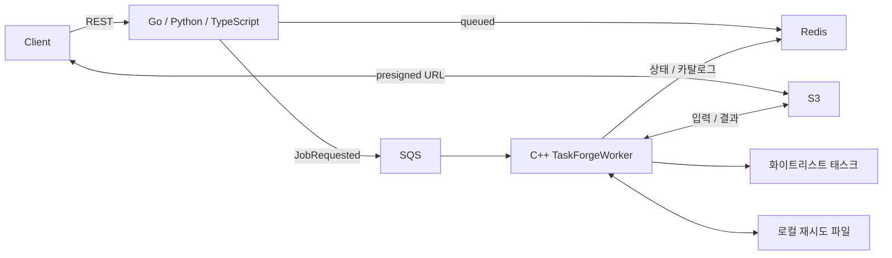

# yirang-taskforge 프로젝트 분석

| 항목 | 내용 |
|---|---|
| 문서 ID | YTF-ANL-001 |
| 버전 | 1.1.0 |
| 기준 표준 | ISO/IEC 25010, ISO/IEC/IEEE 29148:2018 |
| 작성일 / 최종 수정일 | 2026-11-07 / 2026-11-07 |
| 상태 | Active |
| 대상 커밋 | `21888c7` |

## 1. 목적과 범위

요청을 SQS에 등록하고 C++ 워커가 화이트리스트 실행파일을 실행하는 포트폴리오입니다. S3는 입력·결과 파일, Redis는 상태·태스크 카탈로그를 담당합니다. Go·Python·TypeScript는 동일 REST 계약을 독립 구현합니다. 동일 계약의 다언어 구현은 의도된 중복입니다.

웹 콘솔·SaaS·인증·결제·분산 추적은 현재 구현 범위에 없습니다. [확장 제안](NEXTJS_SAAS_TASK_LIST.md)은 현재 개선 작업과 구분합니다. 요구사항은 [SRS](SRS.md), 계약은 [API](API.md), 상세 구조는 [SAD](SAD.md)가 기준입니다.

## 2. 실행 단위와 경계

| 범위 | 실측 구성 | 역할·의존 | 근거 |
|---|---|---|---|
| Main | `.cpp` 6개, 헤더 5개, 태스크 스크립트 2개 | C++23 실행 서비스, CppToolkit·Boost·AWS SDK·Redis | `Main/CMakeLists.txt:14`, `Main/main.cpp:19` |
| Go API | `cmd/api` + `internal` | Gin → 서비스 → S3/SQS/Redis 어댑터, Go 최소 1.24 | `Interface/golang/go.mod:3`, `Interface/golang/cmd/api/main.go:37` |
| Python API | `src/app` | FastAPI → JobService → 동기 boto3/비동기 Redis, Python 최소 3.11 | `Interface/python/pyproject.toml:5`, `Interface/python/src/app/main.py:25` |
| TypeScript API | `src` 모듈 | NestJS·strict TypeScript → JobService → 어댑터 | `Interface/js/src/main.ts:10`, `Interface/js/tsconfig.json:17` |
| 배포 | 서비스 6개, 애플리케이션 이미지 4개 | LocalStack·Redis·워커·API 3종 | `docker/docker-compose.yml:3` |
| 자동화 | CI 잡 4개 | 언어 게이트 3개 → C++ 이미지 빌드와 Compose E2E | `.github/workflows/gates.yml:14` |

Main의 모든 소스가 CMake에 등록되어 있고 선언만 남은 메서드는 발견하지 못했습니다. Tests에는 C++ 코어 실행기와 셸/Python 회귀 검사를 추가했습니다. 앱·설정 범위의 `TODO`·`FIXME`·`NotImplemented` 표시는 없습니다. CppToolkit 공개 API는 외부 소비자 가능성이 있어 삭제 대상으로 판단하지 않았습니다.

## 3. 확인된 개선과 반영 결과

| 분류 | 최종 구현·근거 | 작업 |
|---|---|---|
| 종료 | 신호 선차단·sigwait, 안전한 정리 경로 (`Main/main.cpp:19`) | T-003 완료 |
| 실행 제한 | 프로세스 그룹 종료·자식 신호 마스크 복원 (`Main/TaskExecutor.cpp:26`) | T-004 완료 |
| 상태 일관성 | Redis optional 조회·expected 전파·ACK 보류 (`Main/TaskForgeWorker.cpp:738`) | T-005 완료 |
| readiness | Python/JS 병렬 예산·3종 고정 unavailable (`Interface/python/src/app/api/routes.py:68`) | T-006 완료 |
| 파일 처리 | 두 태스크 dotglob | T-007 완료 |
| API 구조·종료 | Go found/error 구분, JS 최소 Pick 주입·HTTP drain 후 quit | T-008/T-011 완료 |
| 워커 자원 | LongTerm 한 개·protected 모니터·조건 변수 통지, 미사용 priority/상속/future 제거 (`Main/TaskForgeWorker.cpp:225`, `:381`) | T-009 완료 |
| 컨벤션·검증 | Latest 포맷 설정, CTest5·복구4·CI 포맷 게이트 | T-002/T-010 완료 |
| 추적성 | docs 추적 복원과 현재 본문·양방향 매핑 | T-001 완료 |

완료 근거·커밋은 [task_list](task_list.md), 수정한 문제는 [SPR](SPR.md), 실제 시험 강도는 [VERIFICATION](VERIFICATION.md)을 따릅니다. 워커 Redis timeout, 비원자적 재실행 가능성, 입력 계약 편차와 Python lock/mypy는 후속 제한으로 남습니다.

## 4. 현상 유지 판단

| 대상 | 판단 근거 |
|---|---|
| 세 언어 API | 같은 계약을 다른 언어로 구현하는 것이 프로젝트 목적이므로 통합하지 않습니다. |
| TaskForgeWorker 오케스트레이션 | 검증·실행·DLQ가 이미 별도 클래스로 분리되어 있습니다. 파일 길이만으로 새 계층을 만들지 않습니다. |
| Redis/S3 재시도 루프 | 실패 처리 목적이 달라 범용 재시도 추상화로 합칠 근거가 부족합니다. |
| CppToolkit 의존성 | lz4·efsw·cryptopp 등은 서브모듈 빌드가 요구하므로 앱의 직접 호출 유무만으로 제거하지 않습니다. |

## 5. 현재 검증 상태

C++ 빌드와 CTest 등록5/실행5/PASS5, Go build/vet/race, Python ruff/format·pytest8, JS build/lint/format·Jest9, Docker 이미지 빌드·E2E19·격리 복구4그룹을 통과했습니다. C++·TypeScript의 별도 세션 검증과 코드·구조·보안 더블체크를 수행했습니다. `21888c7`은 최종 코드 기준이며 원격 Actions 실행 이력은 저장소에서, 미실행 수동 시험은 STP에서 별도로 확인합니다.

## 변경 이력

| 버전 | 일자 | 변경 |
|---|---|---|
| 1.0.0 | 2026-11-07 | `6f7fb67` 기준 전체 구조·결함·데드 코드·문서 상태 분석 |
| 1.1.0 | 2026-11-07 | 개선점의 최종 구현·회귀·잔여 범위로 현행화 |
