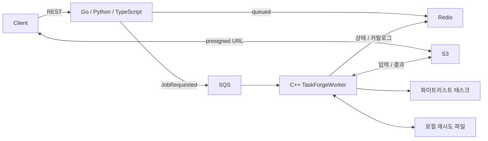

# yirang-taskforge 프로젝트 분석

| 항목 | 내용 |
|---|---|
| 문서 ID | YTF-ANL-001 |
| 버전 | 1.0.0 |
| 기준 표준 | ISO/IEC 25010, ISO/IEC/IEEE 29148:2018 |
| 작성일 / 최종 수정일 | 2026-11-07 / 2026-11-07 |
| 상태 | Active |
| 대상 커밋 | `6f7fb67` |

## 1. 목적과 범위

요청을 SQS에 등록하고 C++ 워커가 화이트리스트 실행파일을 실행하는 포트폴리오입니다. S3는 입력·결과 파일, Redis는 상태·태스크 카탈로그를 담당합니다. Go·Python·TypeScript는 동일 REST 계약을 독립 구현합니다. 동일 계약의 다언어 구현은 의도된 중복입니다.

웹 콘솔·SaaS·인증·결제·분산 추적은 현재 구현 범위에 없습니다. [확장 제안](NEXTJS_SAAS_TASK_LIST.md)은 현재 개선 작업과 구분합니다. 요구사항은 [SRS](SRS.md), 계약은 [API](API.md), 상세 구조는 [SAD](SAD.md)가 기준입니다.

## 2. 실행 단위와 경계

| 범위 | 실측 구성 | 역할·의존 | 근거 |
|---|---|---|---|
| Main | `.cpp` 6개, 헤더 5개, 태스크 스크립트 2개 | C++23 실행 서비스, CppToolkit·Boost·AWS SDK·Redis | `Main/CMakeLists.txt:14`, `Main/main.cpp:24` |
| Go API | `cmd/api` + `internal` | Gin → 서비스 → S3/SQS/Redis 어댑터, Go 최소 1.24 | `Interface/golang/go.mod:3`, `Interface/golang/cmd/api/main.go:37` |
| Python API | `src/app` | FastAPI → JobService → 동기 boto3/비동기 Redis, Python 최소 3.11 | `Interface/python/pyproject.toml:5`, `Interface/python/src/app/main.py:25` |
| TypeScript API | `src` 모듈 | NestJS·strict TypeScript → JobService → 어댑터 | `Interface/js/src/main.ts:10`, `Interface/js/tsconfig.json:17` |
| 배포 | 서비스 6개, 애플리케이션 이미지 4개 | LocalStack·Redis·워커·API 3종 | `docker/docker-compose.yml:3` |
| 자동화 | CI 잡 4개 | 언어 게이트 3개 → C++ 이미지 빌드와 Compose E2E | `.github/workflows/gates.yml:16` |

Main의 모든 소스가 CMake에 등록되어 있고 선언만 남은 메서드는 발견하지 못했습니다. 앱·설정 범위의 `TODO`·`FIXME`·`NotImplemented` 표시는 없습니다. CppToolkit 공개 API는 외부 소비자 가능성이 있어 삭제 대상으로 판단하지 않았습니다.

## 3. 확인된 개선점

| 분류 | 현재 상태 | 근거 | 작업 |
|---|---|---|---|
| 종료 안정성 | 기동 중 SIGTERM에서 연결 객체가 먼저 해제되어 충돌 재현 | `Main/main.cpp:96`, `Main/TaskForgeWorker.cpp:251` | T-003 |
| 실행 제한 | 부모 프로세스 종료 후 자손이 계속 실행됨 | `Main/TaskExecutor.cpp:97` | T-004 |
| 상태 일관성 | Redis 저장 실패가 호출자에게 전파되지 않고 원본 메시지가 삭제됨 | `Main/TaskForgeWorker.cpp:740`, `Main/TaskForgeWorker.cpp:469` | T-005 |
| readiness | Python·JS가 3개 probe를 각각 3초씩 직렬 대기; 총 약 9초 | `Interface/python/src/app/api/routes.py:62`, `Interface/js/src/health/health.controller.ts:30` | T-006 |
| API 종료 | Nest Redis onModuleDestroy가 HTTP drain 전에 호출됨 | `Interface/js/src/infra/redis.service.ts:48` | T-011 |
| 파일 처리 | 숨김 입력 파일이 셸 glob에서 누락됨 | `Main/tasks/wordcount.sh:10`, `Main/tasks/checksum.sh:18` | T-007 |
| 계층 경계 | Go 서비스가 구체 Redis 오류에 의존, JS fake가 이중 타입 단언 필요 | `Interface/golang/internal/service/job.go:13`, `Interface/js/test/jobs.service.spec.ts:27` | T-008 |
| 불필요한 자원 | High/Normal/Low 잡 제출 없이 유휴 워커만 생성 | `Main/TaskForgeWorker.cpp:230`, `Main/TaskForgeWorker.cpp:393` | T-009 |
| 컨벤션 게이트 | 설치된 clang-format 22.1.8이 `Standard: c++23`을 파싱하지 못함 | `.clang-format:39` | T-002 |
| 추적성 | 기존 문서가 과거 실패와 완료 이력을 중첩하고 문서 전체가 Git 제외됨 | `.gitignore:13`, 구 문서 18종 대조 | T-001 |

동적 재현 결과와 검증 범위는 [VERIFICATION](VERIFICATION.md), 결함별 시정 상태는 [SPR](SPR.md)에 기록합니다. 위 항목은 이 문서 기준에서 수정 전이며, 구현 완료를 뜻하지 않습니다.

## 4. 현상 유지 판단

| 대상 | 판단 근거 |
|---|---|
| 세 언어 API | 같은 계약을 다른 언어로 구현하는 것이 프로젝트 목적이므로 통합하지 않습니다. |
| TaskForgeWorker 오케스트레이션 | 검증·실행·DLQ가 이미 별도 클래스로 분리되어 있습니다. 파일 길이만으로 새 계층을 만들지 않습니다. |
| Redis/S3 재시도 루프 | 실패 처리 목적이 달라 범용 재시도 추상화로 합칠 근거가 부족합니다. |
| CppToolkit 의존성 | lz4·efsw·cryptopp 등은 서브모듈 빌드가 요구하므로 앱의 직접 호출 유무만으로 제거하지 않습니다. |

## 5. 문서 정비와 검증

평가·인계 문서의 중복 백로그를 [task_list](task_list.md)로 통합합니다. 역사적 테스트 결과를 현재 통과 근거로 재사용하지 않습니다. SRS의 요구사항 ID는 유지하고 RTM은 실재 코드·자동 테스트·수동 계획을 구분합니다. CppToolkit 실제 API는 [module_usage_guide](module_usage_guide.md)에 정리합니다.

기준선 검증은 C++ 빌드, Go build/vet/race, Python ruff/format/pytest, TypeScript build/lint/jest가 통과했습니다. C++ 자동 테스트는 기준선 0개이며 Docker 6개 컨테이너 정상 기동·E2E 19/0을 확인했습니다. 세부 명령과 결과는 [VERIFICATION](VERIFICATION.md)을 참조합니다.

## 변경 이력

| 버전 | 일자 | 변경 |
|---|---|---|
| 1.0.0 | 2026-11-07 | `6f7fb67` 기준 전체 구조·결함·데드 코드·문서 상태 분석 |
